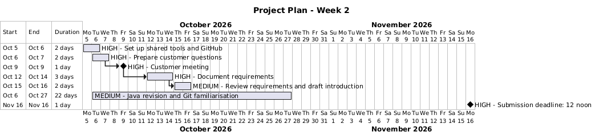
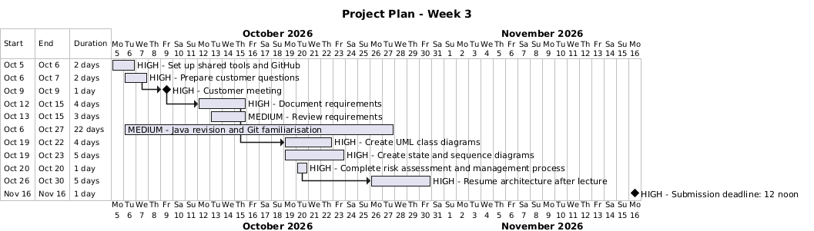
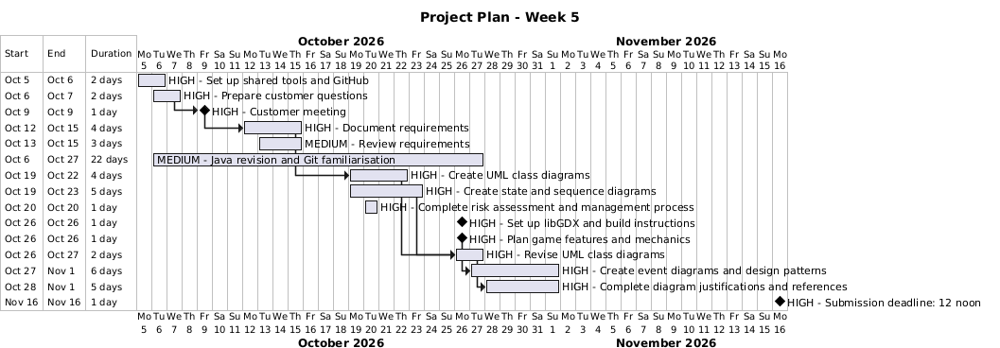

# ENG1GroupProjectTeam11

The engineering project for year 2 semester 1, as a part of the assessed ENG1 group work module.

## Links:
- [Google Drive](https://drive.google.com/drive/folders/1wf2TQGjcnGq4Q_7fKwCeoMQ0QlmTMUd7)
- [GitHub repository](https://github.com/vwz524-eng/ENG1GroupProjectTeam11)
- [Sable server](https://matrix.to/#/!PvJOmQRDZRPErukyOv:york.pub?via=york.pub)

## Details, Setup and Compilation

Base install is libGDX with extentions:
- Ashley
- AI
- Box2D

### Setup

- Use the command: git clone https://github.com/vwz524-eng/ENG1GroupProjectTeam11.git your://directory or use git GUI
- Open gradle project (build.gradle), (Open as project), or (File -> Open Project) or (File -> Import... -> Gradle -> Existing Gradle Project) depending on the IDE
- To run/test: File -> Import... -> Gradle -> Existing Gradle Project 
- To compile, the command ./gradlew lwjgl3:dist will output a runnable  .jar file

## Project Plan

### Introduction

We used a Gantt chart to organise the key tasks required to complete our project. The plan identifies task priorities, start and finish dates, and dependencies between tasks. We reviewed and updated the plan as the project progressed to reflect our team's decisions, progress and changing understanding of the requirements.

The following snapshots show how our project plan evolved over time. Each snapshot builds on the previous version, retaining earlier tasks while displaying changes to task dates, priorities and dependencies.

### Weekly Project Plan Snapshots 

Week 2 - Initial Planning

Week 3 - Risk Management and Initial Architecture 

Week 5 - Revised Architecture and Design 

### Evolution of the Project Plan

Our project plan has evolved throughout the project as we have made progress and identified tasks that needed more time than expected. Initially, we focused on gathering the requirements and beginning the architecture work. However, on 20 October, we prioritised the risk assessment and risk management process while waiting for the architecture lecture, allowing us to continue making progress on other parts of the assessment. On 26 October, we also planned the main game features and mechanics to help inform our UML diagrams and overall design. As the architecture work progressed, we realised that some diagrams needed revising and additional event and design-pattern diagrams were required, alongside justifications and references. This meant the architecture work took longer than originally planned, so we updated our schedule to reflect the remaining tasks and the time available before the deadline. We will continue reviewing the plan as implementation and testing progress.

